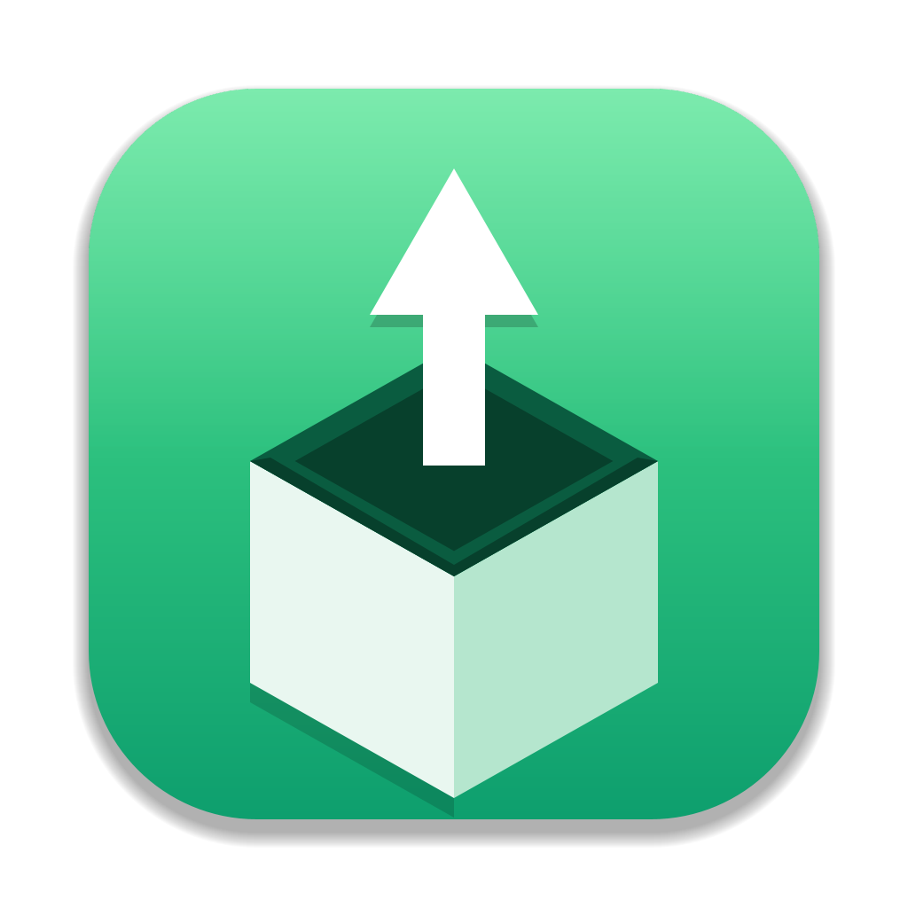

<p align="center"></p>

# AAB to APK Extractor

A small desktop app that turns an Android App Bundle (`.aab`) into an installable **universal APK**, signed with your own keystore.
It wraps Google's [bundletool](https://github.com/google/bundletool) in a simple GUI. Everything it needs (a Java 17 runtime,
bundletool) is bundled, so there is nothing to install.

## Download

Get the package for your computer from the **[Releases](../../releases)** page:

| Computer | File |
|---|---|
| Mac with Apple chip (M1/M2/M3/M4) | `AABtoAPK-<version>-macOS-AppleSilicon.zip` |
| Mac with Intel chip | `AABtoAPK-<version>-macOS-Intel.zip` |
| Windows 10/11 (x64) | `AABtoAPK-<version>-Windows-x64.zip` |

Unzip, then start `AAB to APK Extractor.app` (Mac) or `AAB to APK Extractor.bat` (Windows). Nothing to install, nothing to compile,
and the folder can be copied to another computer.

**macOS first launch:** the app is only ad-hoc signed. If macOS says it is damaged or from an unidentified developer, right-click it → **Open**, or run
`xattr -dr com.apple.quarantine "AAB to APK Extractor.app"`. macOS may ask to allow access to Documents/Downloads/Desktop when you browse them — click **Allow**.
**Windows first launch:** if SmartScreen warns about the `.bat`, choose **More info → Run anyway**.

## Use it

1. **App Bundle** – click Browse or drag the `.aab` onto the window (you can drop an `.aab` and a keystore together).
2. **Keystore** – Browse or drop your `.jks` / `.keystore` / `.p12`. The last keystore is remembered.
3. **Keystore password** – enter it and press **Load aliases** (or Enter); the alias list fills in.
4. **Key alias** – choose one. Fill *Key password* only if the key's password differs from the keystore's.
5. **Convert to APK** – the APK is written next to the AAB as `<name>.apk`. **Show in folder** reveals it.

Browse uses each platform's native file dialog. The **Light / Dark mode** button (top right) switches the theme; dark is the default.
Passwords are never saved; only the last keystore path and the alias chosen per keystore are remembered.

## Build the release packages yourself

On a Mac with JDK 17+, Xcode command-line tools, `curl` and `zip`:

```bash
scripts/package.sh 1.0.0     # downloads bundletool/FlatLaf/JREs into .cache/, writes the zips + SHA256SUMS to dist/
```

| Path | What |
|---|---|
| `src/ApkExtractorApp.java` | the GUI (Java Swing + FlatLaf); calls bundletool in a subprocess |
| `src-mac/` | tiny native macOS launcher (`launcher.c`) and `Info.plist` template |
| `windows/` | Windows launcher script |
| `resources/`, `assets/` | app icon (PNG sizes for the window, `.icns`, `.ico`) |
| `tools/GenIcon.java` | draws the icon and exports all sizes |
| `scripts/package.sh` | builds the three release packages |

## License

[MIT](LICENSE). The release packages include third-party components under their own licenses.

## Third-party software

See [THIRD_PARTY_NOTICES.md](THIRD_PARTY_NOTICES.md).
